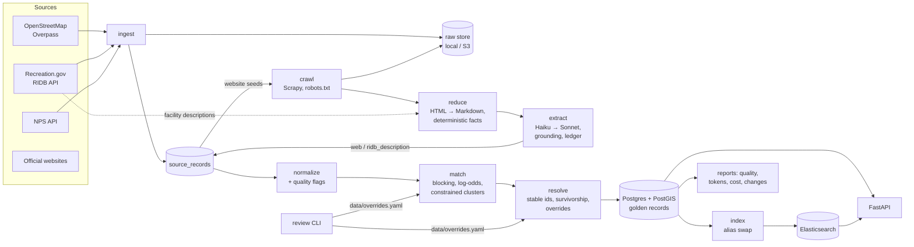

# campground-poi-pipeline

A small, production-minded data pipeline for campground points of interest. It aggregates
records from public sources (OpenStreetMap, Recreation.gov RIDB, the NPS API) and official
campground websites, uses an LLM only where it adds value and as cheaply as possible, resolves
duplicates (including near neighbours that are *not* duplicates), builds golden records with
field-level provenance, measures its own quality and cost, and serves the result through
search and an API. Depth and correctness over breadth: one region (Yosemite and the Eastern
Sierra), where federal, state, county and private campgrounds sit close together.

> **Status.** Everything below the LLM stage is built and measured on real data. The LLM
> extraction stage is **implemented and tested with fixtures, but has not been run live yet**,
> so this README reports no extraction accuracy or cost; those sections fill in after the first
> live run. Entity-resolution labels are Claude-drafted; the human check of a 50-pair sample is
> pending. Progress: [docs/PLAN.md](docs/PLAN.md).

## Architecture



Every stage is a `poi <stage>` command, idempotent, and records a `runs` row with its
parameters and stats. Raw responses are stored once and reprocessed many times.

## Quick start: `make demo`

Needs Docker and [uv](https://docs.astral.sh/uv/). No API keys, no crawling.

```bash
git clone https://github.com/DonkoTonev/campground-poi-pipeline && cd campground-poi-pipeline
make demo
```

It starts PostGIS and Elasticsearch, loads a committed snapshot of the structured records
(contact data scrubbed, see [data/demo/LICENSE.md](data/demo/LICENSE.md)) into its own
database, runs normalize → match → resolve → index, prints example queries and starts the API
on <http://127.0.0.1:8000/docs>. On a machine with warm package and image caches the pipeline
part took 6 seconds; a first run is dominated by downloading the Docker images.

## Full run (with API keys)

```bash
make setup                 # uv sync + git hooks
cp .env.example .env       # RIDB_API_KEY, NPS_API_KEY, ANTHROPIC_API_KEY, CONTACT_URL
make up migrate
make ingest normalize match resolve      # structured sources → golden records
uv run poi crawl --plan && make crawl     # official websites (robots.txt, 1 request/host)
make reduce                               # pages + RIDB descriptions → LLM input documents
uv run poi extract --dry-run              # free token count and cost estimate, nothing generated
uv run poi extract --max-cost-usd 2       # Haiku, escalation to Sonnet; add --batch for 50% off
make normalize match resolve index report
make serve
```

Human-in-the-loop: `uv run poi review label` verifies entity-resolution gold pairs;
`uv run poi review queue` decides gray-zone pairs and field conflicts and writes the decisions
to `data/overrides.yaml`, which every run applies.

## Results

Measured on the `sierra` region on 2026-11-24. Every number comes from a pipeline run; the
reports in [reports/](reports/) are generated from the database.

**Sources → records.** One Overpass query, 54 RIDB pages, one NPS request; a second ingest makes
0 network requests (raw store).

| Source | Records in region | With coordinates | With polygon |
|---|---|---|---|
| OpenStreetMap | 289 | 289 | 158 |
| Recreation.gov RIDB | 89 | 82 (+7 placed by their rec area) | – |
| NPS API | 16 | 16 | – |

RIDB's offset pagination silently skips facilities (CA: 1,936 rows, 1,887 unique ids), so the
adapter combines three listings: the state listing alone found 68 of the 82 located
campgrounds.

**Normalization.** 379 of 394 records are campgrounds; 15 are excluded and flagged (6 organized
camps, 5 cabin-only lodges, 1 day-use area, 3 aggregate pseudo-facilities). 47 ALL-CAPS names
re-cased, 21 P.O.-box addresses, 7 records with (0,0) coordinates, 2 low-precision points and
2 records whose claimed state contradicts their point, all as flags, none fixed silently.

**Entity resolution.** 379 campground records → **300 entities**: 79 duplicates merged,
15 entities confirmed by all three sources, 45 by two; 36 pairs in the review queue; 5 group or
horse areas attached to a parent campground. Upper, Lower and North Pines (within ~300 m) stay
three entities, each confirmed by OSM, RIDB and NPS.

Labels: Claude-drafted labels, 50 human-verified, agreement pending (0/50 verified so far).
The 200 stratified gold pairs were labelled by Claude from the two records alone, blind to the
matcher's score and decision; a person verifies a random 50 without seeing those labels
([reports/er_eval.md](reports/er_eval.md)). Against the drafted labels (189 decisive pairs,
52 matches): precision **1.00** (95% CI 0.92–1.00), recall **0.87** (0.75–0.93), 0 false merges,
7 missed matches (name variants such as "Agnew Meadows Horse Campground" vs "Agnew Horse
Camp", and one OSM campground that two RIDB ids both claim, which the never-merge-two-RIDB-ids
constraint keeps apart).

**Golden records.** Each field is chosen by per-field source trust plus corroboration, with
every alternative and its provenance kept. Mean quality score: 0.58 for single-source
entities, 0.75 for two sources, 0.99 for three. Conflicts flagged instead of guessed:
RIDB's Crane Flat and Wawona points are 3–4 km from where OSM and NPS put them; OSM and NPS
disagree on dump stations at two Pines campgrounds.

**Data gaps** ([reports/quality.md](reports/quality.md)): season dates are known for 5% of
entities, and the breakdown says where to get the rest: 100% of NPS-backed campgrounds have
them, 0% of the 69 Forest Service campgrounds and of the 215 OSM-only ones.

**Crawling.** 121 candidate URLs → 78 crawlable seeds after screening (30 on API domains,
10 booking engines, 2 aggregators, 1 unofficial site skipped). 15 official sites crawled
(77 pages, about 5 per site), 2 dead seeds. 61 seeds are on fs.usda.gov, which answers an
identified crawler with a block page: the crawler stopped after one request and did not work
around it. The same Forest Service descriptions arrive through the RIDB API, which is used as
a separate extraction input (`ridb_description`). No page needed a headless browser.

**Reduction** ([reports/tokens.md](reports/tokens.md)), no LLM involved, token counts estimated
as bytes/4 until calibrated with the API's `count_tokens`:

| Representation | Tokens per page | Share of raw HTML |
|---|---|---|
| raw HTML | 36,437 | 100% |
| cleaned HTML | 2,133 | 5.9% |
| Markdown + salvaged facts | 947 | 2.6% |
| plain text | 927 | 2.5% |

Main-content extraction alone kept only 58% of distinct phone numbers (they live in headers
and footers); a fact-salvage pass brings it to 97% for prices and phones and 96% for months, for
about 7% more tokens. The LLM inputs are 15 website bundles (about 4,300 tokens each) and
85 RIDB description documents (about 760 tokens each).

**LLM extraction.** Implemented and tested with fixtures, **not yet run live**: no accuracy,
cost, cache-hit or escalation numbers yet. [reports/cost.md](reports/cost.md) says the same
until a live run fills it.

**Serving.** Typo-tolerant search ("tuolume medows" finds Tuolumne Meadows), filters by
amenity, month open and category, distance decay; along-route queries return campgrounds in
driving order (Big Oak Flat → Yosemite Valley → Tuolumne lists the Valley campgrounds at
km 23–27 of a 72 km route).

## Edge cases handled

Matching, normalization and crawling cases have tests; the extraction cases are gold cases,
scored once the LLM stage runs live. Cases found in real data are logged in
[docs/DESIGN.md](docs/DESIGN.md#edge-cases-found-in-real-data).

- **Matching:** distinct campgrounds within 200 m (Upper / Lower / North Pines); the same
  campground 600 m apart or with a 4 km coordinate error; same name in different places; name
  variants and abbreviations; group and horse camps next to the family campground; group sites
  inside a campground polygon (child, not merge); shared ranger-district phones; shared
  recreation.gov id with different names; OSM node + way duplicates; distinct RIDB ids that
  must never merge; transitive chains; low-precision coordinates; renames (review, old name
  kept).
- **Normalization:** (0,0), swapped and sign-flipped coordinates, out-of-region points, a
  claimed state that contradicts the point, ALL-CAPS names, phone formats and placeholders,
  "Camp …" names that are youth camps, lodges and day-use areas, meters vs feet, NPS seasons
  encoded as recurring closures, holiday-anchored seasons, stale seasons.
- **Crawling:** robots.txt, Retry-After, soft 404, parked domains, off-domain redirects to
  booking engines, `www` redirects, moved seeds, calendar traps, URL duplicates, SSRF seeds
  (private IPs, cloud metadata), social media, captcha / block pages stopping the whole host,
  PDFs.
- **Extraction** (synthetic gold cases): multi-campground pages, no campground, negations, partial and
  seasonal amenities, holiday seasons, past-year seasons, three kinds of closure, price ranges
  with extra fees, CAD and French, prompt injection, hallucination bait, marketing titles,
  parked domains, very long pages, staff names.

## Design decisions and trade-offs

- **Distance generates candidates and is one feature, never a merge rule.** Conflicting
  discriminators ("Upper" vs "Lower", "Horse" vs none) outweigh being 25 m apart; a shared
  recreation.gov id outweighs a 4 km coordinate error.
- **Precision over recall in matching.** A false merge deletes a real campground from the app;
  a false split shows a duplicate pin. Gray-zone pairs go to review.
- **Explainable scoring.** Fellegi–Sunter-style log-odds with hand-set weights; every decision
  stores its per-feature contributions.
- **Nothing is fixed silently.** Every rule violation is a `quality_flags` row; unknown is
  never "no"; manual fixes are versioned rules in `data/overrides.yaml`.
- **Stable ids.** Entities follow record overlap across runs; merges leave redirects (the API
  answers 301), nothing is deleted.
- **The LLM sees as little as possible.** Deterministic facts first, Markdown at 2.6% of raw
  HTML, one request per site, cheap model first, one escalation, every value grounded in the
  input, confidence computed rather than asked for, every call in a cost ledger with a
  dry-run estimate and a hard cost cap.
- **Postgres is the system of record**, Elasticsearch a rebuildable read model behind an alias.

Deeper rationale, including what changes at 1M POIs: [docs/DESIGN.md](docs/DESIGN.md).
Production sketch on AWS: [docs/aws.md](docs/aws.md).

## Limitations and next steps

- Run the LLM stage live (dry run first) and report accuracy, cost per page and per 1,000 POIs,
  cache-hit and escalation rates, the representation ablation, and how much season and amenity
  coverage each input adds.
- Finish the human check of the 50-pair ER sample and report the agreement rate; then decide
  the merge threshold (pair-level sweep on the drafted labels: at 4, the current setting,
  precision 1.00 / recall 0.88; at 2, precision 0.96 / recall 0.92).
- One region; Forest Service websites are blocked for identified crawlers, so their facts come
  only from RIDB descriptions.
- Token counts in the reduction report are estimates until calibrated with `count_tokens`.
- Real-page extraction gold labels are not committed (third-party content); the committed gold
  set is synthetic.

## Data sources and attribution

- Map data © OpenStreetMap contributors, available under the Open Database License (ODbL).
  The demo snapshot contains OSM-derived records and is made available under the ODbL.
- Recreation Information Database (RIDB), Recreation.gov.
- U.S. National Park Service API.
- State and province boundaries: Natural Earth (public domain).
- No commercial aggregators or review sites are crawled.

## How I built this

I used Claude Code as a pair programmer for planning, implementation and review. I owned the
design decisions and the verification: what to measure, what counts as a correct match, which
trade-offs to make, and checking the numbers against the data.
