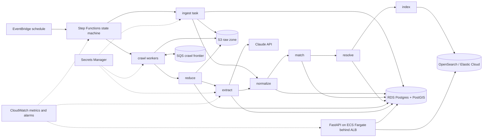

# Running this on AWS (sketch, not deployed)

How the pipeline would run in production on AWS. Nothing here is deployed; the local
setup (Docker Compose, local raw store) maps onto it one component at a time.

## Orchestration

- **EventBridge** triggers a **Step Functions** state machine per region on a schedule: daily
  for the structured APIs, weekly for website re-crawls, and on demand after a config change.
- Each stage is an **ECS Fargate task** running the same container image with a different
  `poi <stage>` command. Stages are already idempotent and record a `runs` row, so a failed
  step is retried by the state machine without side effects; the state machine passes the
  run ids along.
- Extraction is the one stage that fans out: Step Functions submits a **Message Batches** job
  (50% price) and waits on a callback or a polling loop with a long interval; nothing sits
  idle on Fargate during the hours a batch can take.

## Crawling at scale

- An **SQS crawl frontier**: one message per site, with the scope and the conditional-request
  headers from the last crawl. Scrapy workers on Fargate consume it, one host per worker
  slot, so per-host politeness holds across workers. A DynamoDB or Postgres row per host
  records robots.txt, block status and the next allowed fetch time.
- Re-crawls are prioritized by staleness × popularity (see DESIGN.md); unchanged pages are
  answered with 304 and skip reduction and extraction entirely.
- JS rendering (Playwright) runs on a separate, smaller worker pool, only for pages flagged
  `needs_render`.

## Storage

- **S3 raw zone** for gzipped responses, reduced documents and LLM recordings, keyed exactly
  as in the local raw store (`RawStore` already has an S3 implementation, tested with moto).
  Lifecycle rules move old raw versions to Glacier; recordings stay as long as their prompt
  version is in use.
- **RDS Postgres with PostGIS** as the system of record (entities, provenance, ledger,
  flags), with Alembic migrations run as a one-off task before each release.
- **OpenSearch** (or Elastic Cloud) as the search read model, rebuilt per region behind an
  alias swap; a broken index never takes the API down.

## Secrets and access

- API keys (RIDB, NPS, Anthropic) in **Secrets Manager**, injected into task definitions as
  environment variables; nothing in images or config files.
- Least-privilege task roles: crawl workers can write the raw zone and the frontier but not
  read secrets they don't need; only the extraction task can read the Anthropic key.

## Monitoring and alarms (CloudWatch)

The pipeline already records what these alarms need (`runs.stats`, `llm_calls`,
`quality_flags`, `sites`); a small task publishes them as custom metrics after each run.

| metric | alarm when |
|---|---|
| LLM spend per run and per day (from the ledger) | above budget; `--max-cost-usd` is the hard stop, the alarm is the early warning |
| escalation rate, hallucination rate | sudden rise: a prompt or model change went wrong |
| cache hit share of input tokens | drops: a silent prompt-cache invalidator |
| field coverage (season, phone, amenities) per region | drops between runs |
| entities created / merged / retired per run | spikes: a source changed shape or matching regressed |
| freshness: share of entities not seen for N runs | above threshold |
| crawl: blocked hosts, robots-blocked seeds, error rate | new blocks; never worked around, but noticed |
| API p95 latency and 5xx rate | SLO breach |
